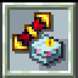

# Scrapped: Classics with modern taste
Scrapped is a modpack project that seeks to remix classic ideas in Minecraft 1.21.1 

Several added items and mechanics are based on classic creations, such as thermal dynamos or extra utilities drums. The project also adds several compatibilities between the mods present, such as new materials for slag and embers, or accessibility for unobtainable items in Omni Utils.

The repository is open in case you need to remove parts of the code. All project authors used are mentioned in the credits section.

## Disclamer
The project is currently in the testing phase and bugs are expected. If you find one, open a ticket in the issues section in the official repository.

## License
The project is under the license [Dont be a jerk](https://github.com/evantahler/dont-be-a-Jerk/tree/master). Please do not use the assets for commercial purposes, as in addition to assets created by me, this repository contains contributions from other authors

## Credits
* [Ships](https://modrinth.com/datapack/ships)
* [Immersive Engineering: Reimmersed](https://www.curseforge.com/minecraft/texture-packs/ie-reimmersed)
* [Obligatory Old Title](https://modrinth.com/resourcepack/obligatory-old-title)
* [Old Water Texture](https://modrinth.com/resourcepack/old-water-texture)
* [Legacy Console Edition Click Sound](https://modrinth.com/resourcepack/legacy-edition-click-sound)
* [Water Bobbu](https://modrinth.com/resourcepack/waterbobbu)
* [Jappa Style Hotbar](https://www.planetminecraft.com/texture-pack/jappa-style-hotbar/)
* ["Device Upgrade" is a remix of "upgrade" item from cobblemon](https://cobblemon.com/en)

## About
[imBL4CK - 2026](https://github.com/imBL4CK)