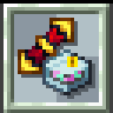

# Machines 
About the machines added by custom machinery: They are clearly based on the machines from the thermal series mod, be it version 1.16+ or 1.12.2, but they are made from cleenroom, I didn't use any source code or anything. 

The textures are based, but made by hand. Regarding the textures on the sides of the machine, I used the textures from the "omni utils" mod as a base, but they were also made from cleanroom

# Custom builders
I based myself on the code of some authors, and during development, I learned how to use the "createCustom" method. The original creators have been credited in the header of all codes that use parts.